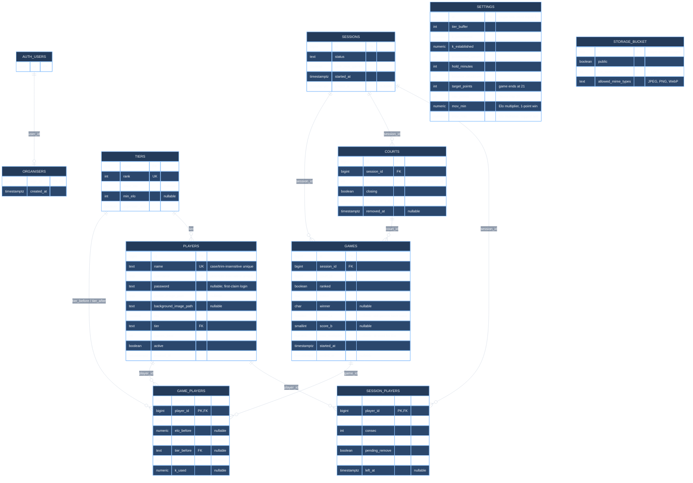

# Current database schema

This diagram combines `court_balancer_schema.sql` with the local migrations in `migrations/` and `supabase/migrations/`. The SQL files define eight application tables. The auth user and Storage bucket are Supabase-managed resources referenced by the project.

## Key constraints

- `session_players` uses `(session_id, player_id)` as its primary key.
- `game_players` uses `(game_id, player_id)` as its primary key.
- A partial unique index allows only one active session, and another allows only one `playing` game per court.
- `courts` has a unique `(session_id, court_no)` pair.
- `games.ranked` defaults to `false`; `sessions.rank_new_games` defaults to `true` (the toggle is hidden in the UI) and controls the setting copied to new games.
- `games.score_a` / `score_b` are both set or both null. When set, they must follow the scoring rule (`private.score_problem`, using `settings.target_points` and `cap_points`) and agree with `winner`; a trigger on `games` enforces the rule for every write.
- `players.username` and both image paths come from the player profile migration. Profile images use the public `player-profile-images` bucket.
- The local SQL schema defines functions and RLS policies in addition to these tables; they are omitted from this entity relationship diagram.
